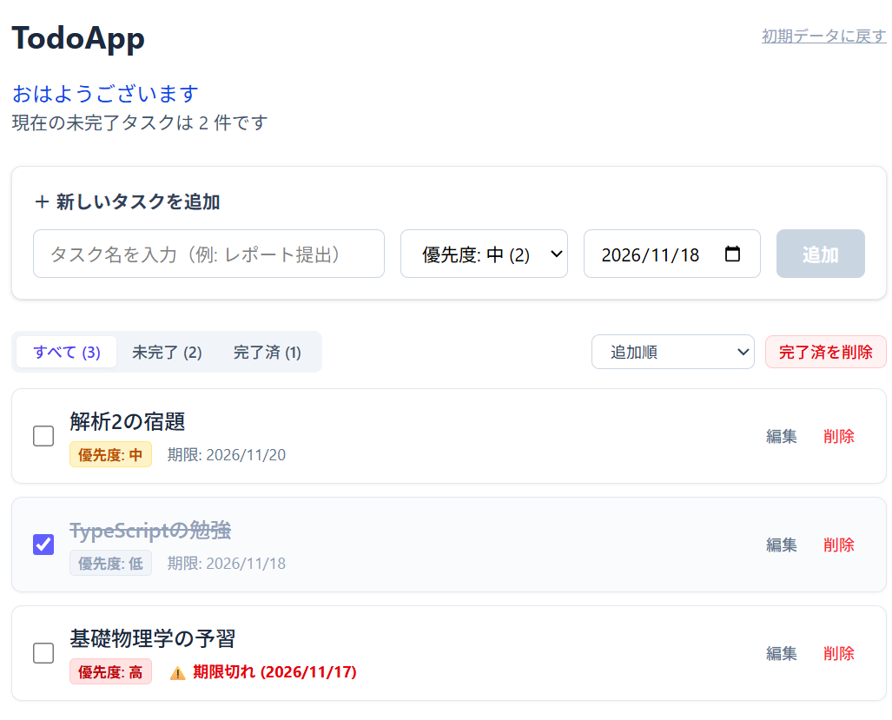
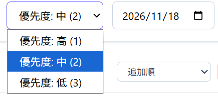
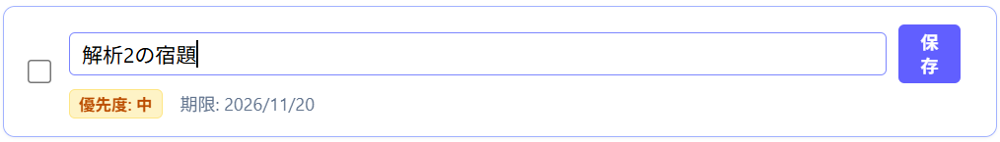
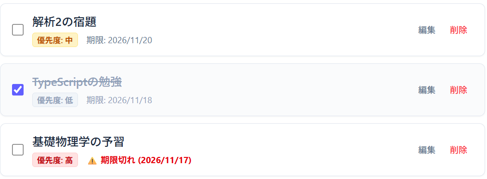
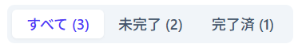
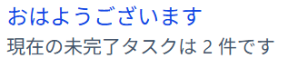

# TodoApp

React、TypeScript、Tailwind CSS を使用し、ローカルストレージでデータを永続化した「Todoアプリ」です。

## 開発履歴

2026年10月11日：プロジェクト開始

# TodoApp - 期限と優先度を直感的に管理するタスク管理アプリ

「気づいたら提出期限を過ぎていた」という日々の課題感を解決するために開発したタスク管理Webアプリケーションです。

**公開URL**: https://sii407.github.io/react-todo-app/

---

## コンセプトと主な機能

日々の学習や作業の中で「今すぐやるべきタスク」を迷わず把握できるよう、視認性と操作の軽快さを重視して設計しました。

- **タスクの追加・完了・削除**
  - タスク名・優先度（高・中・低）・期限を設定して追加できます。
  　

  - チェックボックスによる完了切り替えに加え、完了済みタスクをまとめて整理できる「完了済を削除」機能を備えています。
  　

- **インラインでのタスク名編集**
　
   タスク名をクリック（または「編集」ボタン押下）することでその場でテキストを直接編集でき、`Enter` キーで確定、`Esc` キーでキャンセルが可能です。
- **期限の自動判定と視覚的アラート**
  
  - 現在日付とタスクの期限を自動比較し、**当日が期限のタスク（🔥 今日まで）** と **期限切れのタスク（⚠️ 期限切れ）** を色分けとアイコンで強調表示します。
- **絞り込み（フィルター）＆並び替え（ソート）**
  
  
  - 「すべて / 未完了 / 完了済」のタブ切り替え（各件数表示付き）と、「追加順 / 優先度が高い順 / 期限が近い順」での並び替えに対応しています。
- **未完了タスク数のリアルタイム表示と時間帯別メッセージ**

  
  - 画面上部に時間帯に応じた挨拶と現在の未完了タスク数を表示し、起動直後に残タスク量を一目で把握できます。
- **データの自動保存（永続化）とリセット機能**
  - ブラウザの `localStorage` を活用し、ページをリロードしてもタスク状態が保持されます。初期データへ戻すリセット機能も搭載しています。

---

## 開発の背景と工夫したポイント

### 1. 「期限切れの見落とし」を防ぐUI設計（着想・背景）
自身のスケジュール管理において、単なるリスト形式のメモでは「緊急度の高いタスク」が他の項目に埋もれてしまい、締切直前に慌てることがありました。そこで、単なる日付表示ではなく「今日まで」「期限切れ」を自動で判定して色とアイコンを切り替えるロジックを実装し、開いた瞬間に優先対応すべきタスクが目に飛び込む工夫を取り入れています。

### 2. 入力の手間を最小限にするインライン編集
タスク名のちょっとした修正のために別画面やモーダルを開く操作はストレスになるため、タスク一覧の行内でそのまま入力欄に切り替わるインライン編集を実装しました。キーボード操作（`Enter` / `Esc`）にも対応させ、マウス操作を減らしてテンポよく整理できるようにしています。

### 3. Reactの状態管理におけるイミュータブルな更新
タスクの完了切り替えや編集時には、元の配列やオブジェクトを直接書き換えず（ミューテーションを避け）、`map` やスプレッド構文を用いて常に新しい状態を生成する設計を徹底しました。また、`localStorage` からのデータ復元時には型変換（日付文字列から `Date` オブジェクトへの復元）や例外処理を組み込み、不正なデータが残っていてもアプリがクラッシュしないよう配慮しています。

---

## 使用技術（技術スタック）

| カテゴリ | 技術・ライブラリ |
| :--- | :--- |
| フロントエンド | React 19 / TypeScript |
| ビルドツール | Vite |
| スタイリング | Tailwind CSS v4 / tailwind-merge |
| ユーティリティ | uuid（一意なタスクIDの生成） |
| デプロイ・CI/CD | GitHub Pages / GitHub Actions |

---

## 開発期間

- **開発期間**: 約 8日間（合計 約18時間）

---

## ライセンス

MIT License

Copyright (c) 2026 sii407

Permission is hereby granted, free of charge, to any person obtaining a copy
of this software and associated documentation files (the "Software"), to deal
in the Software without restriction, including without limitation the rights
to use, copy, modify, merge, publish, distribute, sublicense, and/or sell
copies of the Software, and to permit persons to whom the Software is
furnished to do so, subject to the following conditions:

The above copyright notice and this permission notice shall be included in all
copies or substantial portions of the Software.

THE SOFTWARE IS PROVIDED "AS IS", WITHOUT WARRANTY OF ANY KIND, EXPRESS OR
IMPLIED, INCLUDING BUT NOT LIMITED TO THE WARRANTIES OF MERCHANTABILITY,
FITNESS FOR A PARTICULAR PURPOSE AND NONINFRINGEMENT. IN NO EVENT SHALL THE
AUTHORS OR COPYRIGHT HOLDERS BE LIABLE FOR ANY CLAIM, DAMAGES OR OTHER
LIABILITY, WHETHER IN AN ACTION OF CONTRACT, TORT OR OTHERWISE, ARISING FROM,
OUT OF OR IN CONNECTION WITH THE SOFTWARE OR THE USE OR OTHER DEALINGS IN THE
SOFTWARE.